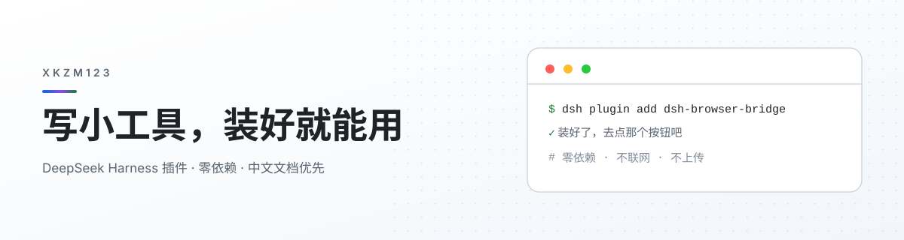

  <picture>
    <source media="(prefers-color-scheme: dark)" srcset="assets/banner-dark.svg">
    <source media="(prefers-color-scheme: light)" srcset="assets/banner-light.svg">
    
  </picture>

  一句话：我做的东西都长一个样 —— <b>装好就能用，不用看文档</b>。

---

## 🧩 在做的三件事

| 项目 | 一句话 | 状态 |
| :--- | :--- | :--- |
| [**dsh-browser-bridge**](https://github.com/xkzm123/dsh-browser-bridge) | 让 AI 点你**已经开着**的那个浏览器。不重启、不装环境、不用记命令 | `v1.3.0` |
| [**awesome-dsh-plugin**](https://github.com/xkzm123/awesome-dsh-plugin) | DSH 插件精选列表，同时也是 npm 上的插件市场索引 | 持续更新 |
| [**local-gallery**](https://github.com/xkzm123/local-gallery) | 一个 `server.js` 把电脑文件夹变成网页，同 WiFi 的手机平板一起看 | 可用 |

## 📦 其他仓库

| 仓库 | 是什么 | 栈 |
| :--- | :--- | :--- |
| [gamified-todo-app](https://github.com/xkzm123/gamified-todo-app) | 游戏化待办，做完任务像在打游戏 | TypeScript |
| [goose-duck-tracker](https://github.com/xkzm123/goose-duck-tracker) | 鹅鸭杀记牌助手，纯前端，可选语音输入和 AI 推理 | JavaScript |
| [mashangpa-crawler-practice](https://github.com/xkzm123/mashangpa-crawler-practice) | 爬虫习题，自己写的答案 | Python |

## 🛠 常用

  

## 📊 数据

  <picture>
    <source media="(prefers-color-scheme: dark)" srcset="https://streak-stats.demolab.com?user=xkzm123&theme=github-dark-blue&hide_border=true&locale=zh&card_width=760">
    
  </picture>

  <picture>
    <source media="(prefers-color-scheme: dark)" srcset="https://raw.githubusercontent.com/xkzm123/xkzm123/output/github-contribution-grid-snake-dark.svg">
    
  </picture>

---

  代码都在这儿，随便翻。有问题直接开 issue。

